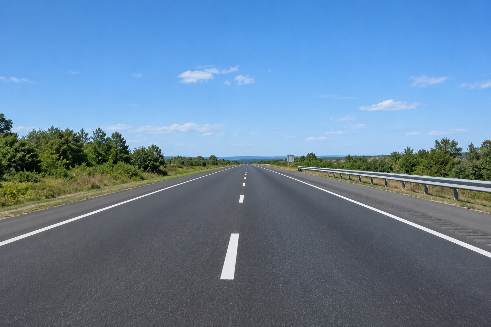
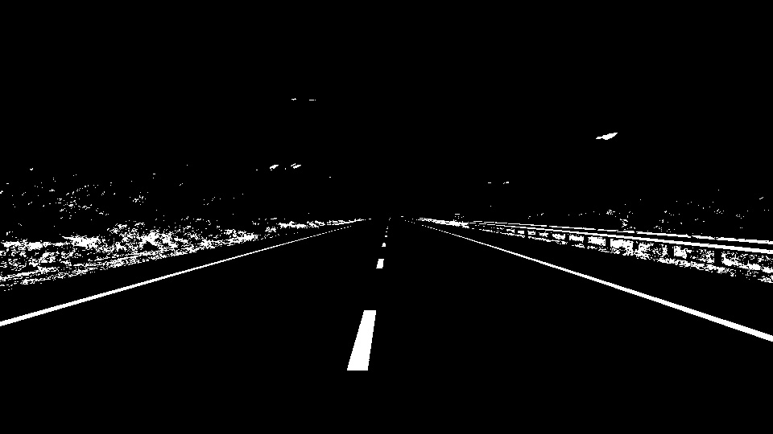
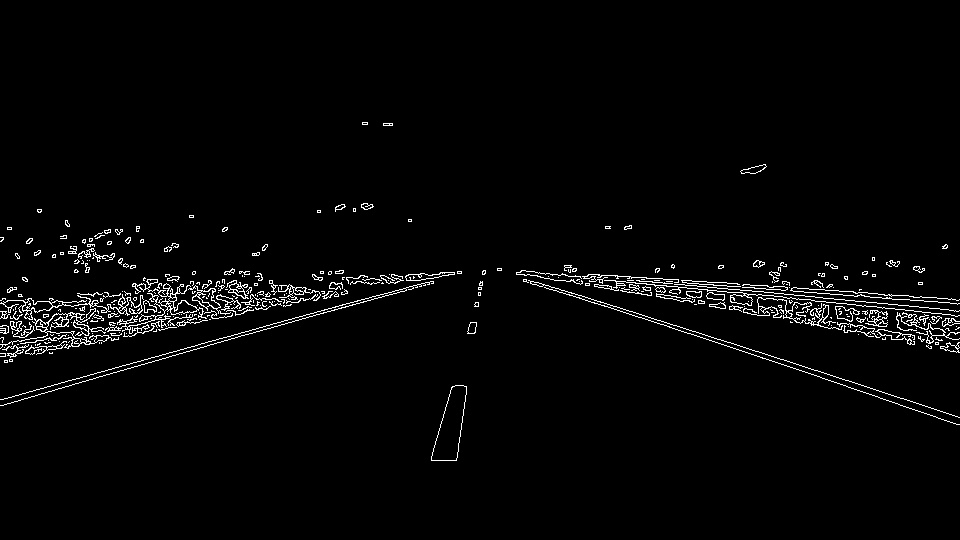
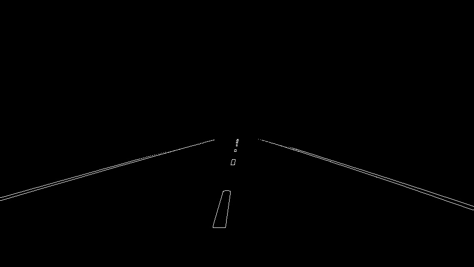

# Lane Line Extractor Using OpenCV

## Project Overview
This project detects lane markings in a static road image using Python, OpenCV, and NumPy. The image goes through HSV colour filtering, Gaussian blurring, Canny edge detection, Region of Interest (ROI) masking, and the Probabilistic Hough Line Transform. The program then draws one red line along each of the left and right lane boundaries and outlines the dashed centre markings in red.

## Objectives
- Load and process a road image using OpenCV.
- Apply HSV colour filtering to identify white and yellow lane markings.
- Use Gaussian blur to reduce image noise.
- Detect edges using the Canny edge detector.
- Apply ROI masking to focus on the road region.
- Detect line segments with the Probabilistic Hough Line Transform and merge them into one line per lane boundary.
- Organise the code into reusable Python functions.

## Technologies Used
- Python
- OpenCV (`cv2`)
- NumPy

## Project Structure

```text
lane-line-extractor/
├── lane_detector.py
├── road.png
├── hsv_mask.jpg
├── colour_mask.jpg
├── blurred.jpg
├── canny_edges.jpg
├── roi_edges.jpg
├── lane_lines.jpg
└── README.md
```

## Installation

Install the required libraries:

```bash
py -m pip install opencv-python numpy
```

## How to Run

Open the project folder in VS Code, open the terminal, and run:

```bash
py lane_detector.py
```

The program loads `road.png` (set by `IMAGE_PATH` at the top of the script), processes it, and saves the results to an `output` folder, which is created automatically if it does not exist. The saved images are the colour mask, the Canny edges, the edges after ROI masking, and the final lane image. Copies of these results are included in this repository so they can be viewed below.

To also open preview windows for each stage, set `SHOW_WINDOWS = True` near the top of the script. This needs a computer with a display.

## Processing Pipeline

1. **Image Loading:** Loads the road image and resizes a working copy to 960 × 540 pixels. The full-size original is kept for detecting the small, far-away centre dashes.
2. **HSV Colour Filtering:** Converts the image to HSV and creates masks for white and yellow pixels, which are combined into one colour mask.
3. **Gaussian Blur:** Smooths the colour mask to reduce noise.
4. **Canny Edge Detection:** Detects edges in the blurred colour mask.
5. **Region of Interest (ROI):** Keeps only the edges inside a polygon covering the road area, which removes the sky, trees, and guardrail.
6. **Hough Line Transform:** Detects short line segments in the remaining edges.
7. **Lane Visualisation:** Sorts the segments into left and right by slope and position, fits one straight line to each side, and draws them in red. The white centre dashes are found separately and outlined in red. The final image is saved.

## Functions Used

- `load_image()` loads the input image and returns a resized working copy along with the full-size original.
- `roi_polygon()` returns the road-shaped polygon used for ROI masking.
- `detect_edges()` applies HSV filtering, Gaussian blur, Canny edge detection, and ROI masking.
- `fit_lane()` fits one straight line through a group of points.
- `detect_lanes()` finds line segments with the Hough transform and draws the left and right lane lines.
- `outline_centre_dashes()` finds the dashed centre markings and outlines them in red.
- `main()` coordinates the pipeline, saves the output images, and optionally shows preview windows.

## Results

### Original Road Image


### HSV Colour Mask
White and yellow pixels kept after colour filtering.



### Gaussian Blur
The colour mask after blurring to reduce noise.


### Canny Edge Detection
Edges found in the blurred colour mask.



### Region of Interest
Edges that remain after masking out everything except the road.



### Final Lane Detection
Left and right lane lines in red, with the centre dashes outlined in red.


## Limitations
- Detection accuracy depends on lane-marking visibility, lighting, and road conditions.
- White or yellow objects other than lane markings may also be detected before ROI masking.
- The ROI polygon is tuned for this image. A different camera angle or road would need different values.
- Each lane boundary is drawn as a straight line, so curved lanes would not be followed accurately.
- The program processes static images rather than live video.

## Conclusion
This project demonstrates a basic computer vision pipeline for lane-line detection using OpenCV. It combines colour filtering, blurring, edge detection, ROI masking, and line detection in a modular Python program.

## Conclusion
This project demonstrates a basic computer vision pipeline for lane-line detection using OpenCV. It combines colour filtering, blurring, edge detection, ROI masking, and line detection in a modular Python program.
This project demonstrates a basic computer vision pipeline for road lane detection using HSV colour filtering, Gaussian blur, Canny edge detection, ROI masking, and Hough line detection.
