# Assignment: Classical Computer Vision & Lane Line Extractor

## Project Overview
The goal of this project is to build a lane line extractor using OpenCV. Static road images are processed to isolate highway lane lines using classical computer vision techniques, laying the groundwork for perception systems.

## Objectives
1. Load and process static road images using OpenCV.
2. Implement HSV color space transformations for robust color filtering.
3. Apply Gaussian blur to reduce image noise.
4. Apply Canny edge detection to identify lane boundaries.
5. Apply Region of Interest (ROI) masking to isolate the road area.

## Technologies Used
- Python
- OpenCV (`cv2`)
- NumPy

## Project Structure
```text
lane-line-extractor/
├── images/
│   └── road.png
├── image/
│   └── image2.png
├── output/
│   ├── image2/
│   │   ├── blurred.jpg
│   │   ├── canny_edges.jpg
│   │   ├── colour_mask.jpg
│   │   ├── combined_edge_mask.jpg
│   │   ├── lane_lines.jpg
│   │   ├── roi_edges.jpg
│   │   └── roi_preview.jpg
│   └── new_image/
│       ├── blurred.jpg
│       ├── canny_edges.jpg
│       ├── colour_mask.jpg
│       ├── combined_edge_mask.jpg
│       ├── lane_lines.jpg
│       ├── roi_edges.jpg
│       └── roi_preview.jpg
├── output1/
│   ├── blurred.jpg
│   ├── canny_edges.jpg
│   ├── colour_mask.jpg
│   ├── hsv_mask.jpg
│   ├── lane_lines.jpg
│   ├── original.jpg
│   └── roi_edges.jpg
├── lane_detector.py
└── README.md
```

## Installation
Install the required libraries:
```bash
py -m pip install opencv-python numpy
```

## How to Run
Open the project folder in VS Code, open the terminal, and run:
```bash
py lane_detector.py
```

---

## Processing Pipeline & Results

### Part 1: Straight Road Scenarios (Probabilistic Hough Line Transform)

The core code utilizes the **Probabilistic Hough Line Transform (`cv2.HoughLinesP`)** to isolate individual lane line segments. These lines are filtered by structural slope characteristics, grouped by road position, and fitted with robust bounding lines to establish linear path equations. The same Hough optimization block is deployed to outline the dashed center markings cleanly.

#### Baseline Road Configuration (`output1/` Directory)

##### 1. Load and Process Static Road Image


##### 2. HSV Color Space Transformation (White & Yellow Filtering)
- **Isolated White Filtering (HSV Mask):**
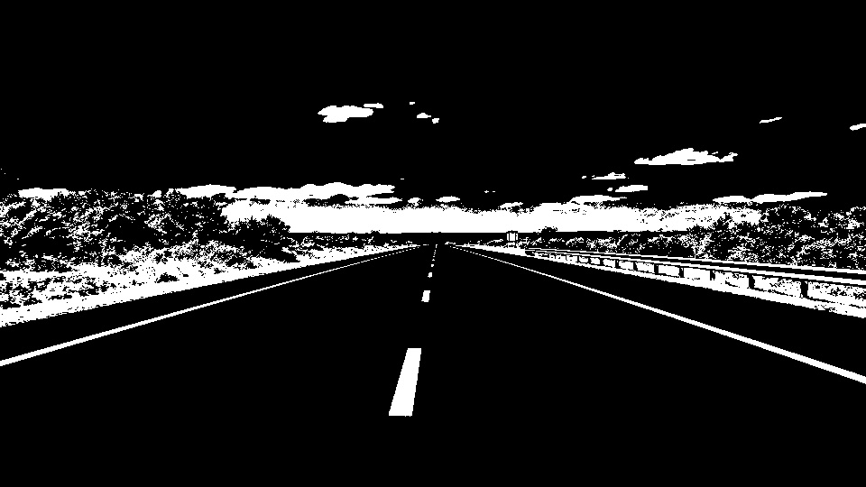

- **Isolated Yellow Filtering (Colour Mask):**


##### 3. Gaussian Blur Mask Output


##### 4. Canny Edge Detection Grid


##### 5. Region of Interest (ROI) Masking


##### Successfully Extracted Lane Lines via Hough Transform (Final Output)


---

#### Alternative Corridor Configuration (`output/new_image/` Directory)

##### 1. Load and Process Static Road Image (ROI Preview)
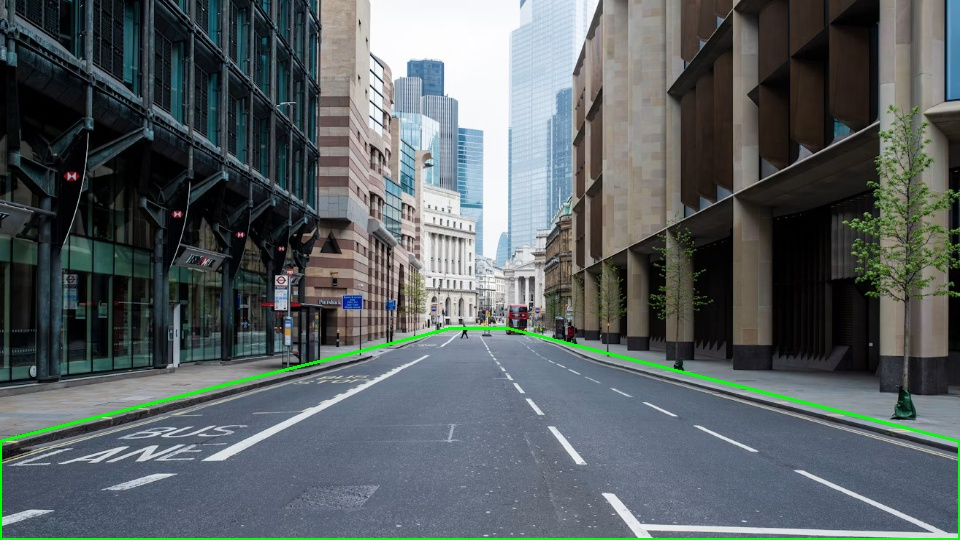

##### 2. HSV Color Space Transformation
- **Isolated Target Markings:**
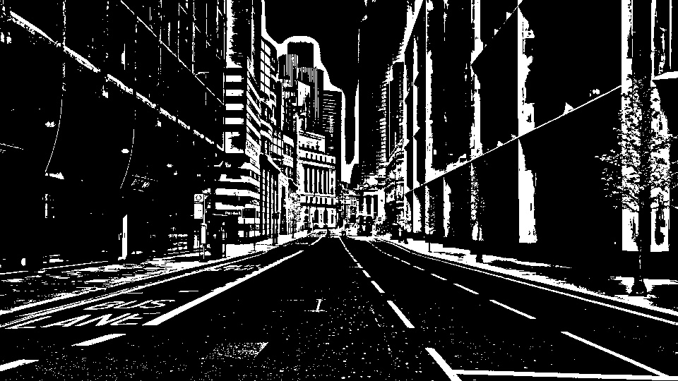

- **Combined Tracking Layers:**
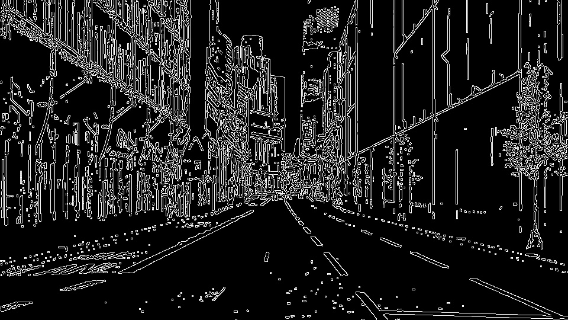

##### 3. Gaussian Blur Mask Output


##### 4. Canny Edge Detection Grid
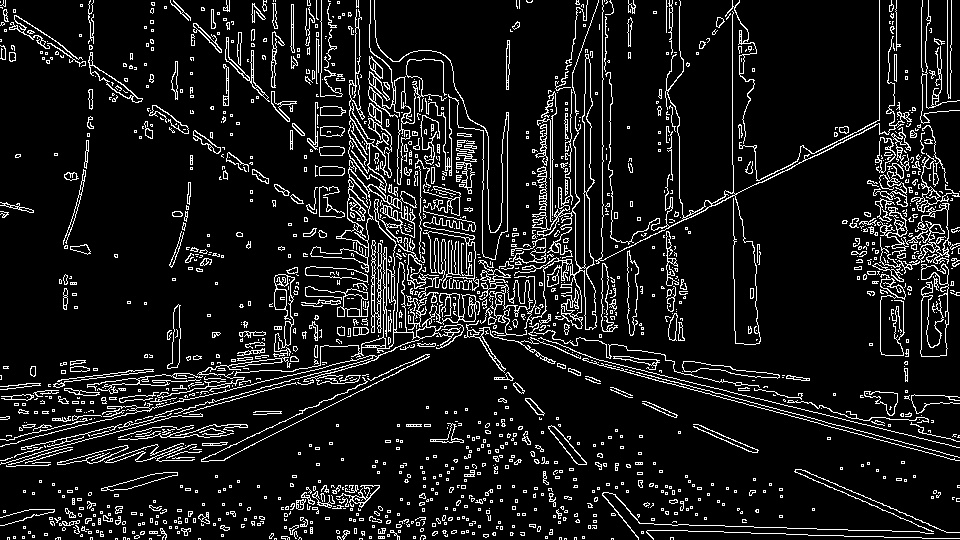

##### 5. Region of Interest (ROI) Masking
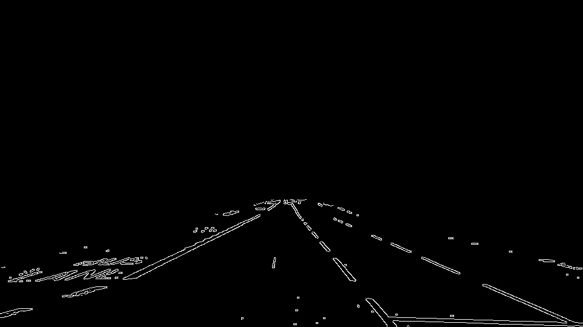

##### Successfully Extracted Lane Lines via Hough Transform (Final Output)


---

### Part 2: Curved Road Scenario (`output/image2/` Directory)

#### 1. Load and Process Static Road Image (ROI Preview)
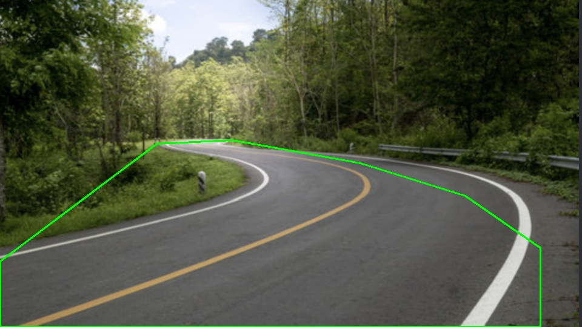

#### 2. HSV Color Space Transformation
- **Isolated Target Markings:**
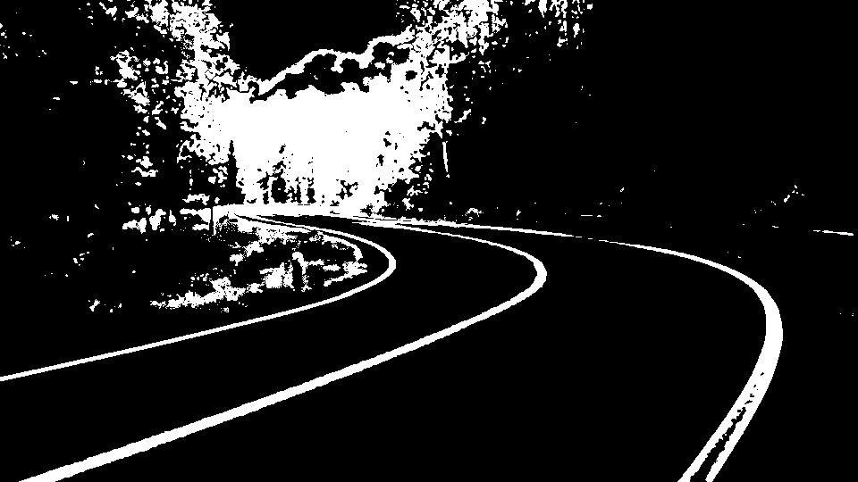

- **Combined Tracking Layers:**
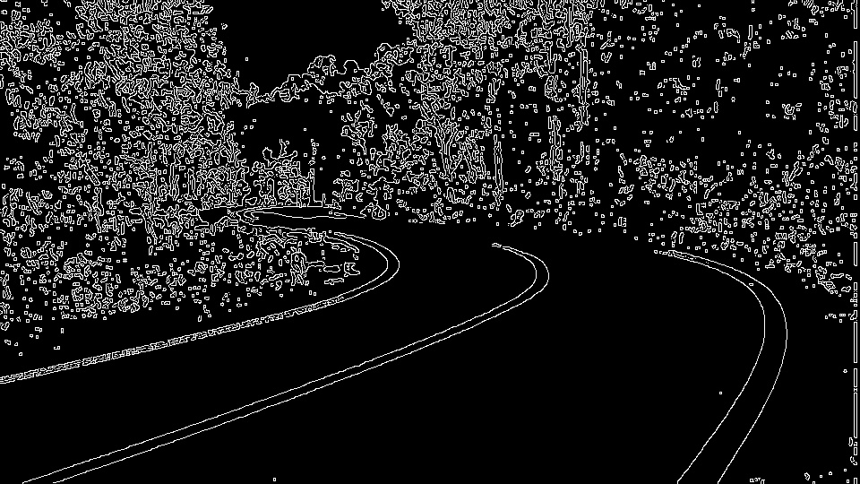

#### 3. Gaussian Blur Mask Output
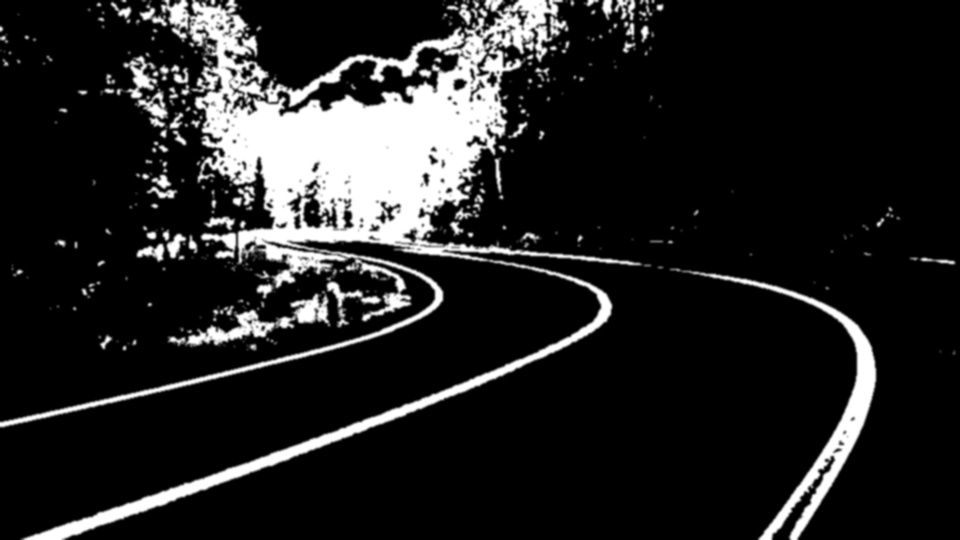

#### 4. Canny Edge Detection Grid
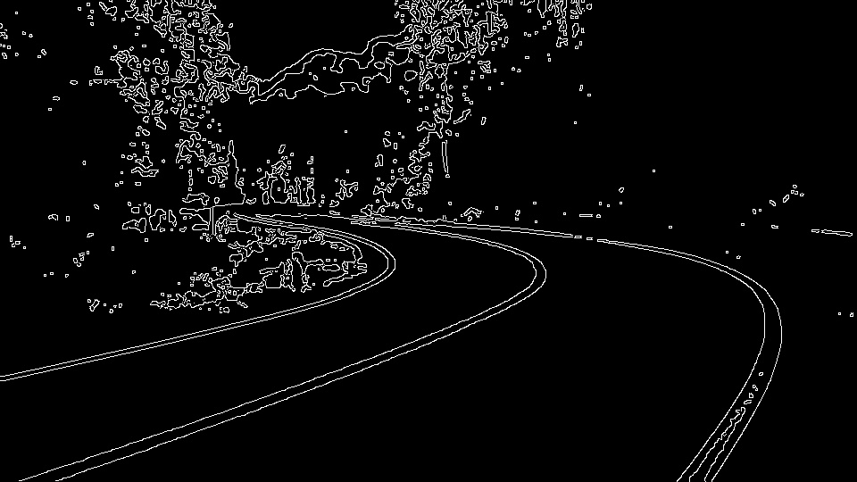

#### 5. Region of Interest (ROI) Masking
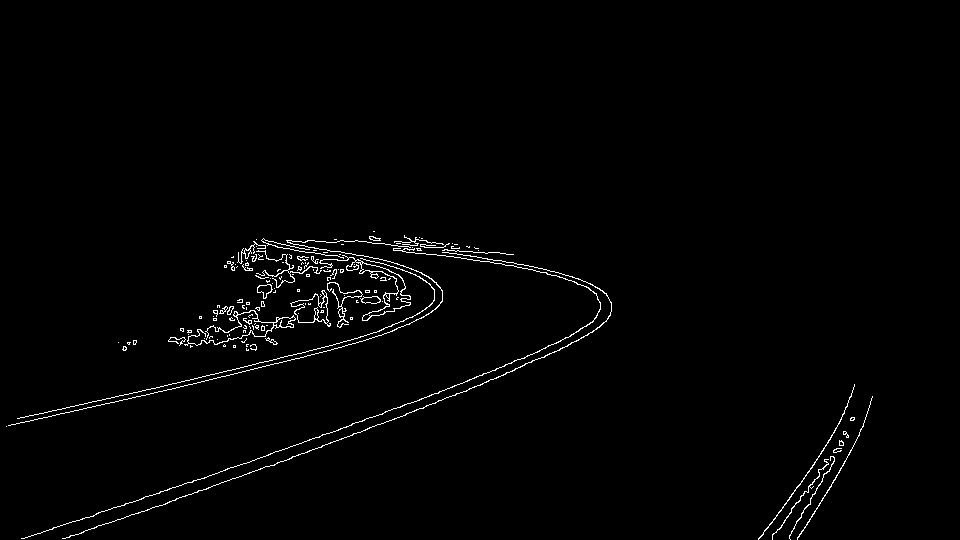

#### Successfully Extracted Lane Lines (Final Output)


---

## Limitations
- Performance depends on clear paint visibility and distinct pavement-to-shoulder contrast breaks.
- Extremely sharp right-angle curves or urban intersections can exceed the horizontal boundaries of the sliding search windows.
- The Region of Interest polygon coordinates are manually configured per image; radical camera positioning changes require updated baseline vector dimensions.

## Conclusion
This framework demonstrates a classical computer vision solution built to track lane parameters across diverse driving environments. By leveraging window tracking, directional gradients, Hough transforms, and finite difference math, the system delivers precise path estimation for both straight city streets and winding highways.


