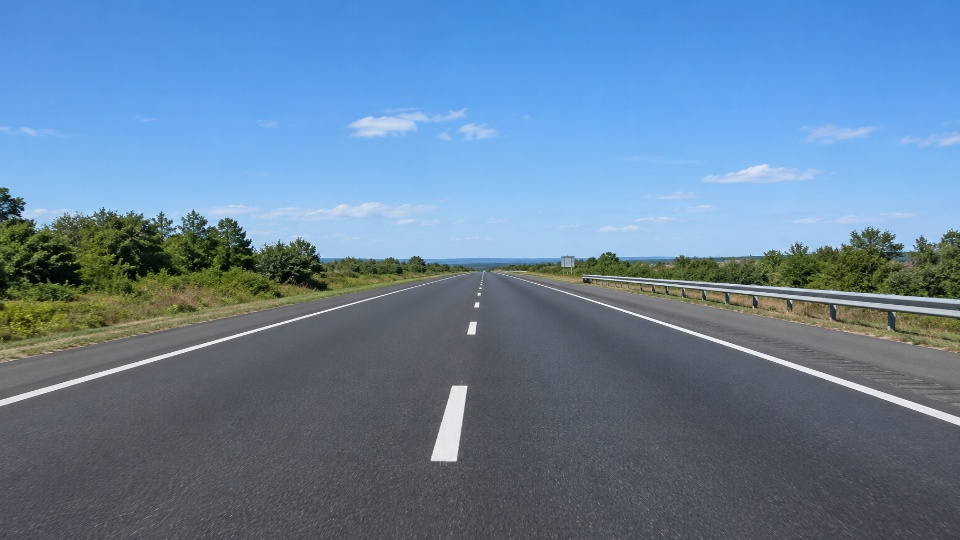
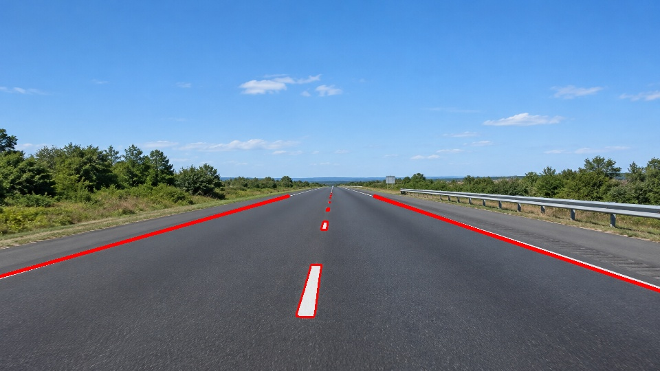

# Lane Line Extractor Using OpenCV

## Project Overview

This project implements a basic lane line detection system using Python and OpenCV. It processes a static road image through image-processing techniques to identify road lane markings and highlight detected line segments in red.

## Objectives

- Load and process a road image using OpenCV.
- Convert the image from BGR to HSV colour space.
- Filter white and yellow regions to identify possible lane markings.
- Apply Gaussian blur to reduce image noise.
- Use Canny edge detection to identify edges.
- Apply a Region of Interest (ROI) mask to focus on the road area.
- Detect line segments using the Probabilistic Hough Line Transform.
- Display and save the final lane detection result.

## Technologies Used

- Python
- OpenCV (`opencv-python`)
- NumPy

## Project Structure

```text
lane-extractor-new/
├── images/
│   └── road.png
├── output/
│   ├── original.jpg
│   ├── hsv_mask.jpg
│   ├── blurred.jpg
│   ├── canny_edges.jpg
│   ├── roi_edges.jpg
│   └── lane_lines.jpg
├── lane_detector.py
└── README.md
```

## Image Processing Pipeline

### 1. HSV Colour Filtering

The road image is converted from BGR to HSV colour space. Thresholding is used to isolate likely white and yellow lane markings.

### 2. Gaussian Blur

Gaussian blur reduces small variations and noise in the filtered image before edge detection.

### 3. Canny Edge Detection

The Canny algorithm identifies edges in the blurred image.

### 4. Region of Interest (ROI)

A polygon mask restricts edge detection to a selected road-shaped region, reducing irrelevant edges outside the region.

### 5. Lane Line Detection

The Probabilistic Hough Line Transform detects line segments from the ROI edges. The detected segments are drawn in red on the original road image.

## Output Results

The program saves the intermediate results and final output in the `output` directory.

### Original Road Image



### HSV Colour Mask


### Gaussian Blur


### Canny Edge Detection


### Region of Interest


### Final Lane Detection



## Installation

Install the required libraries using:

```bash
py -m pip install opencv-python numpy
```

## How to Run

1. Place the input road image at `images/road.png`.
2. Open a terminal in the project directory.
3. Run the Python script:

```bash
py lane_detector.py
```

4. View the processing windows and check the saved images in the `output` directory.

## Limitations

The accuracy of lane detection depends on image lighting, road conditions, colour thresholds, and ROI placement. The system detects line segments and may also identify unwanted edges or miss some lane markings.

## Conclusion

This project demonstrates a basic computer vision pipeline for road lane detection using HSV colour filtering, Gaussian blur, Canny edge detection, ROI masking, and Hough line detection.
