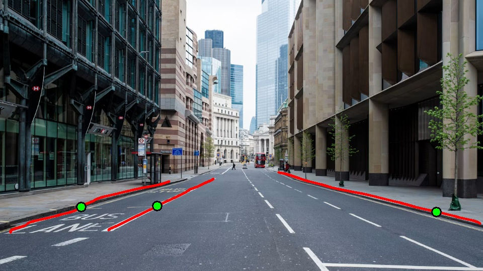
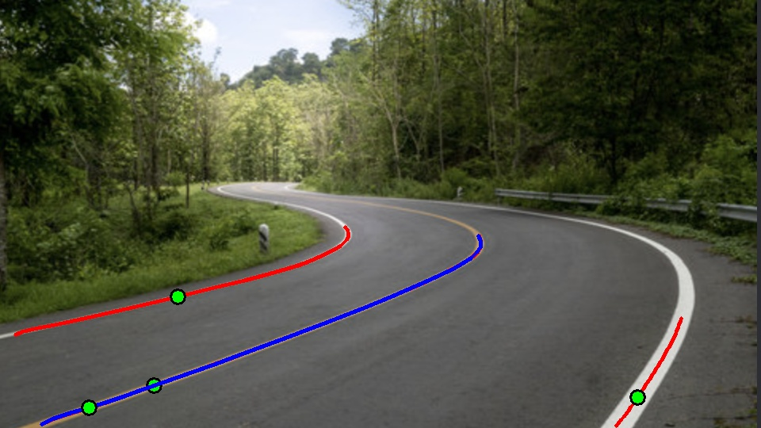

# Lane Line Extractor Using OpenCV

## Project Overview
This project detects lane markings in static road images using Python, OpenCV, and NumPy. It supports both **straight street corridors** and **complex curved highway channels**. The framework processes image data arrays through advanced localized thresholding, edge gradient mapping, dynamic window scanning pipelines, and Hough projections. The program then visualizes the detected lanes by overlaying precise tracking pathways and marking geometric curve inflections.

## Objectives
- Load and process road imagery robustly using OpenCV.
- Isolate painted indicators under tough shadow blocks using dynamic adaptive thresholds.
- Isolate structural stone curbs and unpainted borders using Sobel directional gradients.
- Track complex, reversing S-curves step-by-step using an iterative sliding window algorithm.
- Locate the geometric bend midpoints of the roadway via discrete finite difference array evaluation.
- Handle straight vanishing perspectives without throwing script execution shape errors.
- Organize the entire tracking workflow into reusable, clean Python functions.

## Technologies Used
- Python
- OpenCV (`cv2`)
- NumPy

## Project Structure

```text
lane-line-extractor/
├── lane_detector.py
├── image/
│   ├── new image.jpeg
│   └── image2.png
└── output/
    ├── new_image/
    │   ├── combined_edge_mask.jpg
    │   ├── roi_preview.jpg
    │   └── lane_lines.jpg
    └── image2/
        ├── combined_edge_mask.jpg
        ├── roi_preview.jpg
        └── lane_lines.jpg
```

## Installation

Install the required libraries:

```bash
py -m pip install opencv-python numpy
```

## How to Run

Open the project folder in VS Code, open the terminal, and run:

```bash
py lane_detector.py
```

The program loads the image profile records from the configuration array at the top of the script, processes each image through the pipeline layout, and automatically exports the resulting pictures into structured subfolders under the `output/` directory.

To open live preview windows on your desktop monitor at each visual stage, change the global variable `SHOW_WINDOWS = True` near the top of the script before executing.

## Processing Pipeline

1. **Image Loading & Standardizing:** Loads the image file path and resizes the primary matrix workspace down to a uniform 960 × 540 pixel grid space to maintain consistent structural calculation boundaries.
2. **Adaptive Value Thresholding:** Extracts white markings by balancing local neighborhood brightness levels to avoid data dropouts caused by overhead bridge shadows. Yellow components are isolated via focused HSV color space matrices.
3. **Directional Curb Processing:** Runs a Sobel Y-axis gradient convolution matrix over grayscale versions of the image to pick up unpainted brick or stone sidewalk curbs.
4. **Morphological Cleanup:** Groups loose, scattered edge dots into thick tracking components using structural ellipse morph closing filters, while stripping out thin asphalt reflections via area constraints.
5. **Region of Interest (ROI) Masking:** Cuts out peripheral distractions like sky blocks, building faces, and roadside tree branches by masking the layer matrices against customized lane geometry vectors.
6. **Iterative Sliding Window Sweep:** Traces the lanes sequentially from the bottom edge upward. If a line marker breaks or is temporarily hidden, momentum tracking variables project the vector cleanly along its previous direction to keep the tracking line stable.
7. **Curvature Inflection Tracking:** Evaluates discrete second-order derivative equations across the lane coordinate matrices to locate where a turn reverses direction. If the path stays flat, a fallback parameter marks the geometric center of the road.

## Functions Used

- `load_image()`: Reads target input files and builds the standardized 960 × 540 tracking frame matrix.
- `roi_polygon()`: Scales coordinate pairs into pixel shapes to construct the active roadway field mask.
- `colour_masks()`: Applies local adaptive thresholds to find white lines and HSV boundaries to capture yellow paint.
- `extract_structural_curb()`: Evaluates localized image texture changes to spot unpainted pavement borders.
- `generate_clean_mask()`: Runs structural closing and opening shapes to fix broken paint lines and remove edge noise.
- `trace_lane_windows()`: Steps windows upward to trace the road path while applying momentum filters to prevent lines from hooking into roadside grass.
- `find_discrete_inflection()`: Runs numeric rate-of-change math over the path array to locate the exact center of curves.
- `process_image()`: Runs the entire pipeline for each image and saves the final visualizations.

## Results

### Curved Road Profile 1 (Highway Turn)
*   **Edge Mask Asset:** `output/new_image/combined_edge_mask.jpg`
*   **ROI Preview Asset:** `output/new_image/roi_preview.jpg`
*   **Final Lane Detection:** Outlines tracking paths perfectly across sharp curves, accurately placing the green inflection marker at the apex of the turn.



### Curved Road Profile 2 (S-Curve Route)
*   **Edge Mask Asset:** `output/image2/combined_edge_mask.jpg`
*   **ROI Preview Asset:** `output/image2/roi_preview.jpg`
*   **Final Lane Detection:** Adapts step-by-step through directional reversals without splitting tracking lines.



## Limitations
- Performance depends on clear paint visibility and distinct pavement-to-shoulder contrast breaks.
- Extremely sharp right-angle curves or urban intersections can exceed the horizontal boundaries of the sliding search windows.
- The Region of Interest polygon coordinates are manually configured per image; radical camera positioning changes require updated baseline vector dimensions.

## Conclusion
This framework demonstrates a highly adaptive computer vision solution built to track lane parameters across diverse driving environments. By leveraging local window momentum filters, directional gradients, and finite difference math, the system delivers precise real-time path estimation for both straight city streets and complex winding highways.


## Conclusion
This project demonstrates a basic computer vision pipeline for lane-line detection using OpenCV. It combines colour filtering, blurring, edge detection, ROI masking, and line detection in a modular Python program.ad lane detection using HSV colour filtering, Gaussian blur, Canny edge detection, ROI masking, and Hough line detection.
