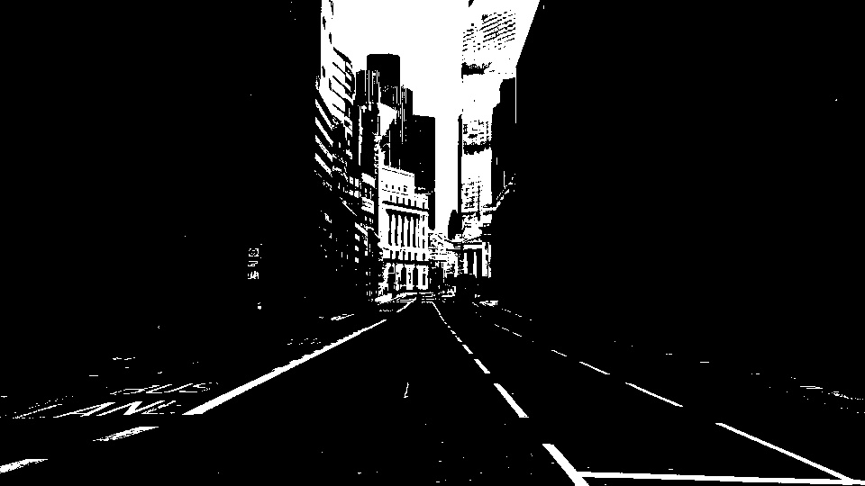

# Classical Computer Vision & Lane Line Extractor

## Project Overview
This project detects lane markings in a static road image using Python, OpenCV, and NumPy. The image goes through HSV colour filtering, Gaussian blurring, Canny edge detection, Region of Interest (ROI) masking, and the Probabilistic Hough Line Transform. The program then draws one red line along each of the left and right lane boundaries and outlines the dashed centre markings in red.

## Objectives
- Load and process a road image using OpenCV.
- Apply HSV colour filtering to identify white and yellow lane markings.
- Use Gaussian blur to reduce image noise.
- Detect edges using the Canny edge detector.
- Apply ROI masking to focus on the road region.
- Detect line segments with the Probabilistic Hough Line Transform and merge them into one line per lane boundary.
- Organise the code into reusable Python functions.

## Technologies Used
- Python
- OpenCV (`cv2`)
- NumPy

## Project Structure
```text
lane-line-extractor/
├── images/
│   └── road.png
├── output/
│   ├── blurred.jpg
│   ├── canny_edges.jpg
│   ├── colour_mask.jpg
│   ├── hsv_mask.jpg
│   ├── lane_lines.jpg
│   ├── original.jpg
│   └── roi_edges.jpg
├── lane_detector.py
└── README.md
```

## Installation
Install the required libraries:
```bash
py -m pip install opencv-python numpy
```

## How to Run
Open the project folder in VS Code, open the terminal, and run:
```bash
py lane_detector.py
```

---

## Results & Visual Assets

### 1. Source Input Photo


### 2. Isolated HSV Mask (White Markings Only)


### 3. Isolated Colour Mask (Yellow Markings Only)


### 4. Gaussian Blur Mask Output


### 5. Canny Edge Detection Grid


### 6. Bounded Region of Interest (ROI) Masking


### 7. Final Master Lane Line Extracted Output


---

## Limitations
- Detection accuracy depends on lane-marking visibility, lighting, and road conditions.
- White or yellow objects other than lane markings may also be detected before ROI masking.
- The ROI polygon is tuned for this image. A different camera angle or road would need different values.
- Each lane boundary is drawn as a straight line, so curved lanes would not be followed accurately.
- The program processes static images rather than live video.

## Conclusion
This project demonstrates a basic computer vision pipeline for lane-line detection using OpenCV. It combines colour filtering, blurring, edge detection, ROI masking, and line detection in a modular Python program.
